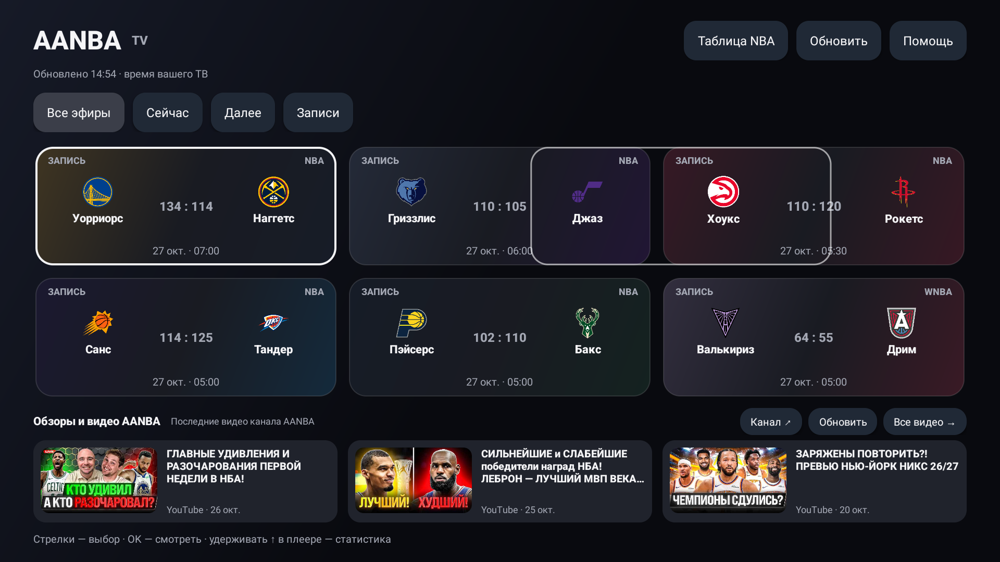

# AANBA TV

Неофициальное бесплатное приложение для **Android TV / Google TV 8.0+**: трансляции AANBA, записи и статистика NBA с управлением обычным пультом. Открытый исходный код, без своего сервера и аккаунта в приложении.

**[Скачать APK 1.4.1](https://github.com/jerkgab/aanba-tv/raw/refs/heads/main/downloads/AANBA-TV-1.4.1.apk)** · [Контрольная сумма](downloads/SHA256SUMS) · [Установка и пульт](docs/INSTALL.md) · [Приватность](PRIVACY.md) · [Проверки и ограничения](docs/VALIDATION.md)

Это тестовая публичная версия для установки APK вручную. Совместимость со всеми моделями телевизоров не заявлена.



## Возможности

- Своя главная: эфиры, ближайшие матчи и записи, логотипы команд, актуальный счёт и избранные.
- Официальный VK-плеер **внутри приложения**, шкала перемотки, пауза, звук и реальные настройки качества VK.
- Продолжение записи с места остановки; прогресс на карточке и кнопка «С начала».
- Удержание ↑ открывает правую панель: видео уменьшается, рядом командная статистика и box score игроков.
- Таблица Востока / Запада / дивизионов, аналитика, календарь команды, показатели сезона и прошлые сезоны.
- Избранные команды сохраняются на устройстве; их матчи выделены золотым.
- Ролики AANBA с YouTube с названиями и превью; нажатие открывает установленный YouTube / SmartTube.

[Все скриншоты и подписи](docs/SCREENSHOTS.md)

## Что исправлено в 1.4.1

Раздел YouTube больше не исчезает при сбое ленты. Есть «Обновить», прямой переход на канал и подписанная стартовая подборка из сборки с локальными превью. После восстановления сети она заменяется свежими публикациями. Загрузка изображений использует отдельную ограниченную очередь и не задерживает расписание/статистику. Добавлены проверки безопасных ссылок, ограничены перенаправления сетевых запросов и обработан сбой процесса WebView.

## Как это работает

```text
Телевизор → AANBA: расписание и публичные ссылки VK
          → VK: официальный встроенный плеер и видеопоток
          → ESPN: счёт, box score, таблица и календарь
          → YouTube / ytimg: публичная лента и превью
```

Нет сервера автора, ретранслятора и общей базы пользователей. Установки независимы: другие зрители не используют телевизор или интернет автора. На десяти устройствах будут десять отдельных клиентов источников. Скачивание APK идёт с GitHub. Это архитектурное свойство, а не гарантия доступности сторонних сервисов.

Расписание и ссылки обновляются автоматически; каждую неделю пересобирать APK не нужно. Статистика обновляется периодическими запросами примерно раз в 20 секунд и может опережать видео. История, избранные и кэш хранятся локально. API-ключи, пароли, личные cookies и доступ к телевизору автора не требуются.

## Совместимость и ограничения

- Нужны Android TV / Google TV 8.0+, исправный Android System WebView и доступ к AANBA, VK и ESPN из сети устройства.
- APK без нативных библиотек: ARM32, ARM64 и x86 не разделены по процессору. Это не означает проверку каждой модели.
- Samsung Tizen, LG webOS и Apple TV этот APK не запускают. Телефонный интерфейс отдельно не адаптирован.
- YouTube / SmartTube нужен только для обзоров. Его отсутствие или недоступность YouTube не мешают просмотру матчей VK.
- Удалённая / закрытая запись, региональная недоступность, неподдерживаемый кодек и ограничения самого VK остаются ограничениями источника. 4K доступно только при наличии такого качества у видео.
- Разметка VK и публичные JSON-интерфейсы ESPN не гарантированы поставщиками. При их изменении приложение может потребовать обновления. Начать лучше с небольшой группы тестировщиков.
- Официальный плеер VK может сам загружать рекламу и служебные ресурсы. Приложение не содержит собственных рекламных SDK, метрик или сбора телеметрии.

## Сборка из исходников

JDK 17, Android SDK 35 / Build Tools 35.0.0. SDK укажите через `ANDROID_HOME` или личный `local.properties`.

```sh
./gradlew testDebugUnitTest lintDebug assembleDebug assembleDebugAndroidTest
```

APK разработчика: `app/build/outputs/apk/debug/app-debug.apk`. Он подписан локальным отладочным ключом вашей машины и не обновляет официальный APK с другой подписью. Для release требуется собственный закрытый ключ через переменные `AANBA_KEYSTORE`, `AANBA_STORE_PASSWORD`, `AANBA_KEY_ALIAS`, `AANBA_KEY_PASSWORD`. Без них `assembleRelease` создаёт **неподписанный** APK. Ни одного ключа подписи в репозитории нет.

Выложенный APK сохраняет подпись предыдущих личных версий 1.3/1.4 для обновления без удаления данных; это не сборка для Google Play. Закрытый ключ хранится только у сопровождающего. Открытый сертификат в APK не позволяет подписывать обновления.

Модульные проверки и сборка выполняются также в GitHub Actions. Инструментальные тесты запускайте на явно выбранном тестовом устройстве — [команды и сценарии](docs/VALIDATION.md).

## Код и обратная связь

Исходный код приложения — [MIT](LICENSE); обозначения, данные и медиаматериалы сторонних владельцев перечислены в [NOTICE](NOTICE). Это независимый клиент сообщества. Если нашли ошибку, создайте Issue с моделью ТВ, Android/WebView и шагами воспроизведения, без паролей, cookies и личных данных.
