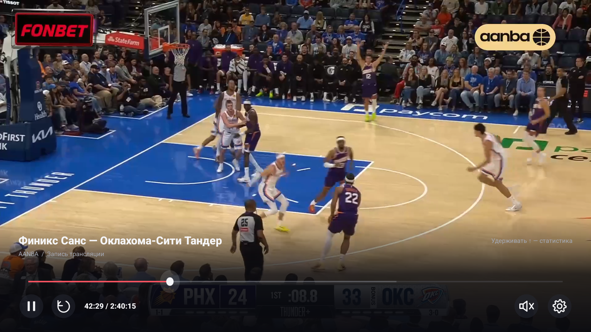
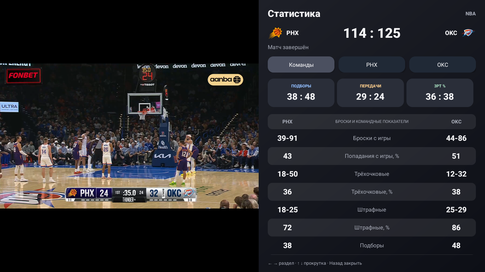
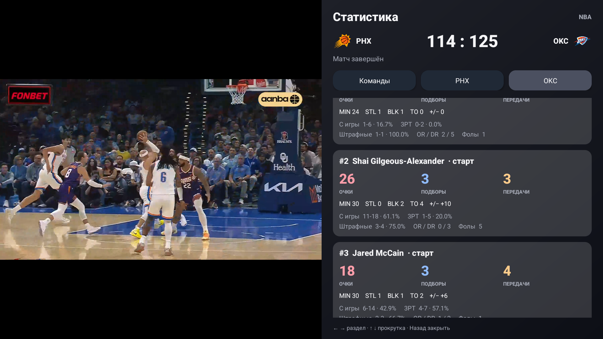

# Скриншоты

## Настоящая запись VK на физическом ТВ

Эти три изображения 1920×1080 сняты 27 октября 2026 года с физического Android TV в установленной публичной версии **1.4.1**. Воспроизводится доступная публичная запись AANBA «Финикс Санс — Оклахома-Сити Тандер». Кадры и интерфейс не дорисовывались. Логотипы и реклама в самом видео принадлежат исходной записи.

Матч уже завершён: правая панель показывает **итоговые** данные 114:125. Статистика записи не синхронизируется с выбранной минутой видео.

### Плеер и управление записью

### Видео рядом с командной статистикой

### Видео рядом с box score игроков

## Дополнительные экраны на эмуляторе

Следующие изображения 1920×1080 сняты в работающем приложении на Android TV API31 27 октября 2026 года. Это скриншоты интерфейса, без дорисовки кадров или элементов. В каталоге AANBA и статистике ESPN используются реальные публичные данные на момент съёмки. На скриншоте box score показан завершённый MIN @ CLE, а не текущий live.

## Главная: матчи, записи и YouTube

## Компактная таблица NBA

## Показатели сезона команды

## Box score игроков

## Выбор любимых команд

## Видео AANBA с YouTube

Подробности проверок и оставшиеся ограничения — в [VALIDATION.md](VALIDATION.md).
