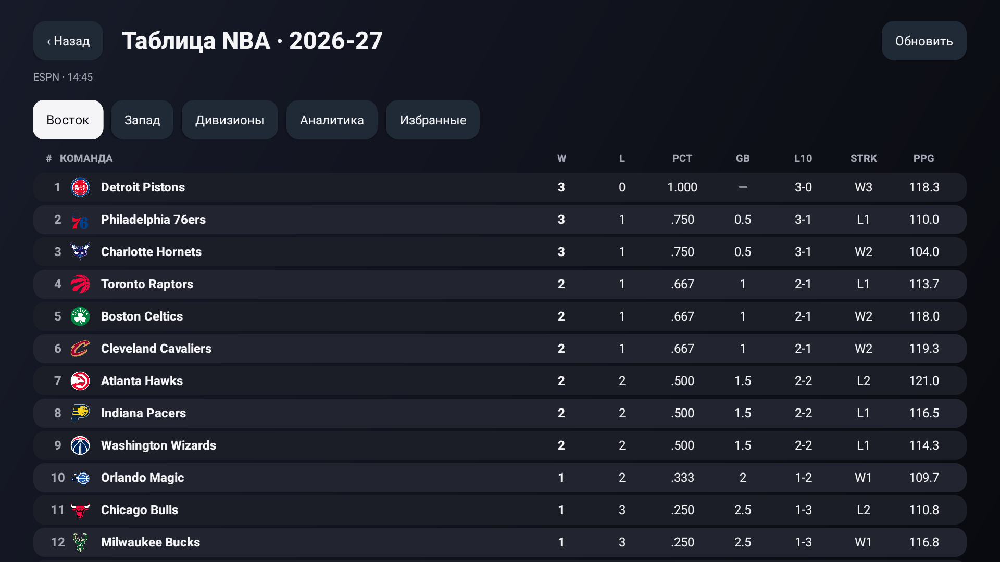
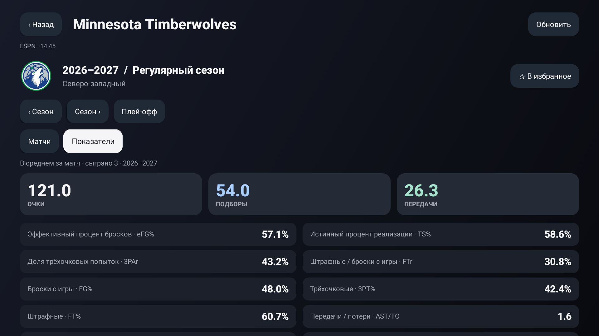
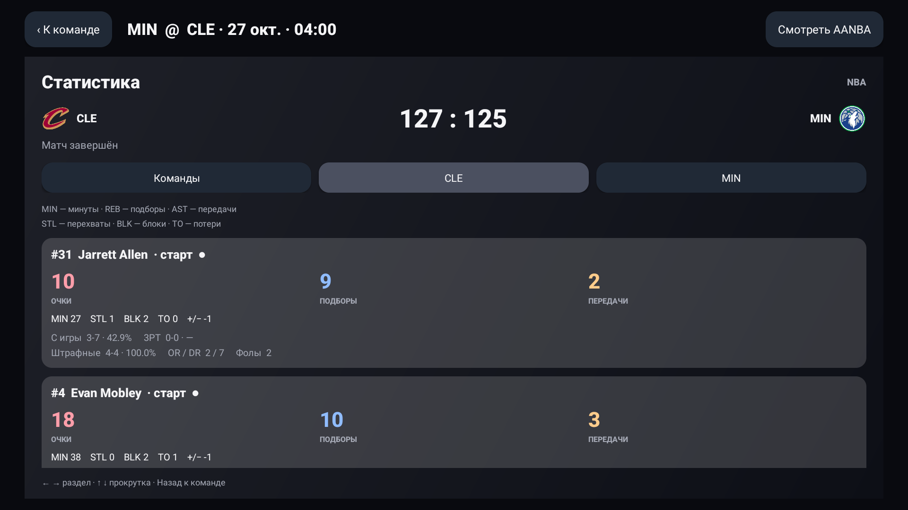
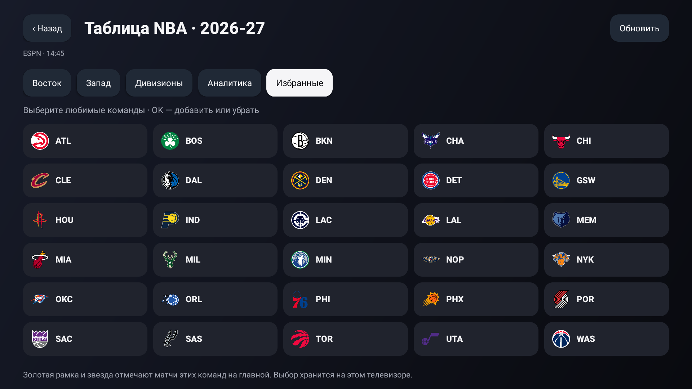
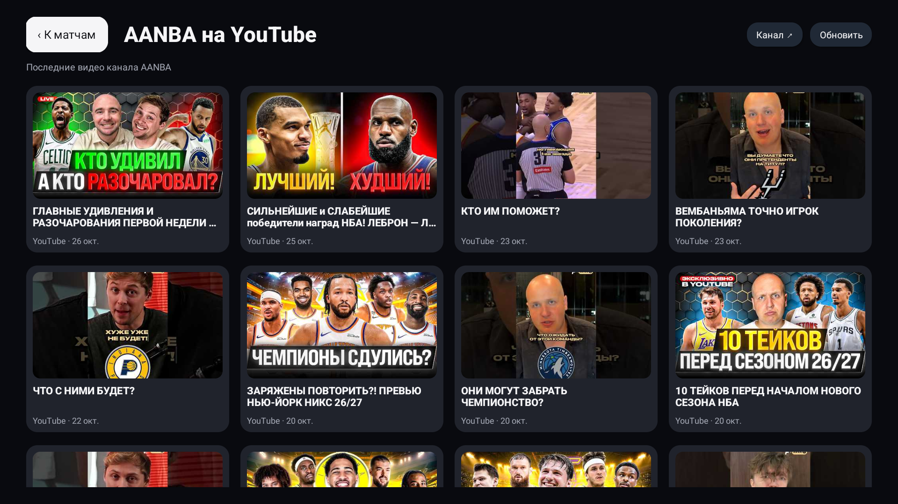

# Скриншоты

Изображения 1920×1080 сняты в работающем приложении на Android TV API31 27 октября 2026 года. Это скриншоты интерфейса, без дорисовки кадров или элементов. В каталоге AANBA и статистике ESPN используются реальные публичные данные на момент съёмки. На скриншоте box score показан завершённый MIN @ CLE, а не текущий live.

## Главная: матчи, записи и YouTube

## Компактная таблица NBA

## Показатели сезона команды

## Box score игроков

## Выбор любимых команд

## Видео AANBA с YouTube

Видео VK на этом эмуляторе не подтвердило готовность, поэтому выдуманного кадра трансляции и рекламного изображения «работающего VK» здесь нет. Подробности аппаратных проверок — в VALIDATION.md.
